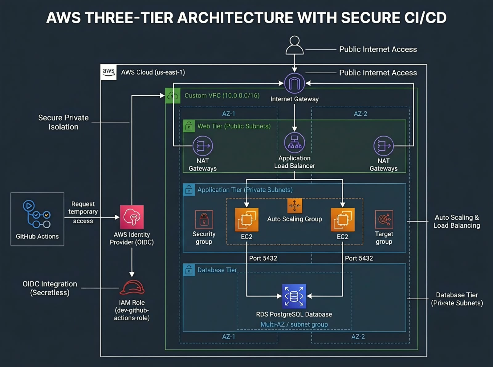

# Secure, Cost-Aware Three-Tier Platform on AWS

## 📖 Overview
This repository contains the Infrastructure as Code (IaC) required to provision a highly available, enterprise-grade three-tier web application architecture on AWS. 

Designed with a focus on strict network isolation, automated scaling, and security best practices, this project bridges the gap between traditional data center operations and modern public cloud automation. Deployments are handled via a **zero-secrets CI/CD pipeline** using GitHub Actions and AWS OpenID Connect (OIDC).

## 🏗️ Architecture


### Infrastructure Highlights
* **Networking (VPC):** A custom VPC spanning multiple Availability Zones with strictly segmented public, private application, and private database subnets.
* **Compute & Routing:** An Application Load Balancer (ALB) routes public traffic to EC2 instances managed by an Auto Scaling Group (ASG) in the private tier.
* **Database:** A Multi-AZ RDS PostgreSQL database resides in the deeply isolated database subnets, accepting traffic only from the application tier.
* **Secretless CI/CD:** Fully automated deployment using GitHub Actions via an OpenID Connect (OIDC) identity provider. No long-lived AWS Access Keys are stored in GitHub.
* **Observability:** Integrated VPC Flow Logs and CloudWatch for active traffic and server metric monitoring.

## 🛠️ Technology Stack
* **Cloud Provider:** AWS (us-east-1)
* **Infrastructure as Code:** Terraform (v1.10.0)
* **CI/CD:** GitHub Actions
* **Authentication:** AWS IAM OpenID Connect (OIDC)
* **Core AWS Services:** VPC, ALB, EC2, ASG, RDS, NAT Gateway, IAM, CloudWatch

## 🚀 Deployment Instructions

### Prerequisites
* An AWS Account.
* Terraform installed locally (v1.10.0+).
* An OIDC Identity Provider configured in your AWS IAM Console pointing to GitHub Actions.

### Local Deployment
If you wish to deploy or test the infrastructure locally:
1. Clone the repository:
   ```bash
   git clone https://github.com/Prathamesh-Wadile/secure-threetier-platform.git
   cd secure-threetier-platform/environments/dev
   ```
2. Initialize Terraform:
   ```bash
   terraform init
   ```
3. Format and validate the code:
   ```bash
   terraform fmt -recursive
   terraform validate
   ```
4. Review the deployment plan:
   ```bash
   terraform plan
   ```
5. Provision the infrastructure:
   ```bash
   terraform apply -auto-approve
   ```

### CI/CD Pipeline (GitHub Actions)
This project includes a fully automated pipeline (`.github/workflows/terraform.yml`). 
* The pipeline is triggered automatically on `push` or `pull_request` to the `main` branch.
* **Authentication:** The pipeline securely authenticates to AWS using an IAM Role equipped with a strict Trust Policy that matches this specific repository via OIDC.
* **Checks:** Enforces `terraform fmt -check` to ensure code quality before applying changes.

## 🧹 Cost Management & Cleanup
To avoid unnecessary AWS charges, ensure all resources are destroyed when not actively in use.
```bash
cd environments/dev
terraform destroy
```
*Note: Destroying the infrastructure will also remove the Terraform-managed OIDC IAM roles. You will need to recreate the Identity Provider connection for future automated pipeline runs.*

## 🧠 Lessons Learned
A significant portion of this project was dedicated to mastering AWS IAM Trust Policies. Resolving OIDC authentication failures required in-depth troubleshooting of case-sensitivity mismatches, internal GitHub ID injections, and dynamic TLS thumbprint synchronization between Terraform and AWS IAM. 